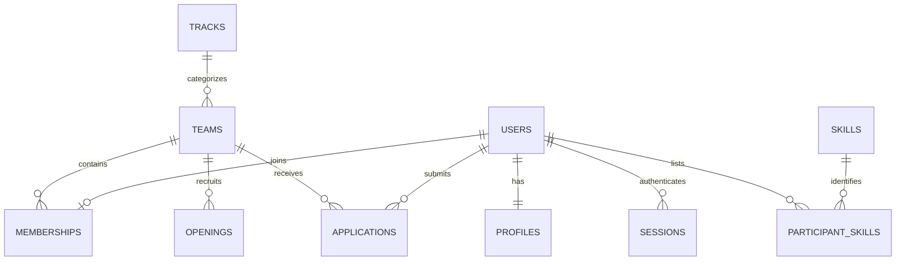

# Design and database documentation

## Objective

Help students find complementary teammates across a hackathon's tracks. Team formation is relational and integrity-sensitive. Free-text project requirements and participant experience need semantic retrieval, justifying the vector paradigm.

## Functional requirements

Participants register, edit profiles/skills, browse tracks/teams, create teams with a recruitment opening, apply, withdraw and leave. Captains review candidates, decide applications, transfer leadership and delete their team. Admins create tracks and control registration. Authenticated users perform semantic discovery. Backend validates roles and ownership independently of the UI.

## Architecture

Browser -> Next.js interface -> Next.js Route Handlers -> PostgreSQL tables/views/functions + pgvector.
Local Transformers.js MiniLM inference creates query vectors. `npm run embed` batch-refreshes profile/opening vectors. No external inference API or synchronization between databases is needed.

## ER diagram

## Data dictionary / relational schema

| Table              | Key and relationships                                                          | Significant attributes / constraints                                                 |
| ------------------ | ------------------------------------------------------------------------------ | ------------------------------------------------------------------------------------ |
| users              | PK id; UNIQUE email                                                            | name, lowercase email, password_hash, participant/admin role, created_at             |
| sessions           | PK token_hash; FK user_id -> users CASCADE                                     | expires_at; only token hash stored                                                   |
| profiles           | PK/FK user_id -> users CASCADE                                                 | bio <= 2000 chars, preferred_role, availability enum, looking, embedding vector(384) |
| skills             | PK id; UNIQUE name                                                             | nonempty skill name <= 40 chars                                                      |
| participant_skills | composite PK(user_id,skill_id), both FKs CASCADE                               | normalized many-to-many skill association                                            |
| tracks             | PK id; UNIQUE name                                                             | description, max_members 2..8, registration_open                                     |
| teams              | PK id; UNIQUE name; FK track_id -> tracks                                      | idea 10..2000 chars, created_at                                                      |
| memberships        | PK/FK user_id -> users; FK team_id -> teams CASCADE                            | one team per user, is_captain; partial unique captain index                          |
| openings           | PK id; FK team_id -> teams CASCADE                                             | title, requirement description, embedding vector(384)                                |
| applications       | PK id; FKs user_id -> users, team_id -> teams CASCADE; UNIQUE(user_id,team_id) | message, pending/accepted/rejected/withdrawn/closed status, timestamp                |

One application per participant/team is intentional: withdrawal/rejection does not enable resubmission to that same team. Users and tracks are not deleted through the UI. Team deletion removes recruitment and application records and returns members to discovery.

## Integrity and concurrency

`memberships.user_id` makes multi-team membership impossible. `team_capacity` locks the parent team row before counting occupants. All application writes use PostgreSQL's default READ COMMITTED isolation. Application acceptance locks the team, then applicant user, rechecks pending state, and invokes a capacity-enforced insert. The function's statement is atomic; an exception rolls back every change. Other pending applications close only on successful membership creation. Concurrent acceptances for a final slot serialize on the team lock; the second observes capacity and fails. Competing teams trying to recruit the same user also meet the unique membership constraint and user lock. PostgreSQL may abort one transaction in a deadlock; the client can refresh/retry, and no partial membership persists.

Team creation and captain membership are one transaction. Leadership transfer holds the team row lock and demotes/promotes in one transaction. The partial unique index prevents two captains. The API preserves at least one captain for extant teams; that final invariant is an application transaction rule, not a deferred database constraint. The database trigger disallows lowering a track's capacity. Closing registration prevents new team creation/application/acceptance after the operation observes closure; it does not dismantle existing teams.

## Vector model and retrieval

Input = participant preferred role + bio + normalized skill names; opening input = role title + description. Model = `Xenova/all-MiniLM-L6-v2`, q8 weights, mean pooling and L2 normalization, 384 dimensions. Model downloaded once and cached locally. Embeddings live in vector(384) columns with cosine HNSW indexes. Search uses `<=>`; smaller distance ranks first. Results exclude unavailable participants, the requesting user and existing members. Team results require space and open registration. Displayed ranks are semantic order, not calibrated probabilities of success.

HNSW is useful at scale but PostgreSQL can correctly choose a sequential scan for the small seed dataset. Filtered approximate search can underfill results at scale; evaluate query plans and iterative scan/oversampling before expanding beyond the demo. Missing vectors produce explicit setup errors/empty results rather than fake matches. Saving a profile clears its vector until batch refresh. The batch job is intended for one operator while profile edits are paused.

## Rubric mapping

| Requirement                       | Implementation                                                           |
| --------------------------------- | ------------------------------------------------------------------------ |
| SQL + second paradigm             | PostgreSQL relational tables + pgvector semantic retrieval               |
| ER and relational schema          | This document and sql/001_schema.sql                                     |
| CREATE / ALTER / DROP             | Schema + transactional disposable demo in sql/demo_queries.sql           |
| INSERT / UPDATE / DELETE / SELECT | Registration, profile updates, skill replacement, memberships, discovery |
| Advanced SQL (4+)                 | Transactions, stored function, capacity trigger, views, indexes          |
| Vector concept                    | MiniLM embeddings and cosine similarity retrieval                        |
| Complex queries                   | Joins, aggregate dashboard, HAVING, subquery in demo_queries.sql         |
| Next.js + backend                 | App Router and Route Handlers                                            |
| Two roles                         | Participant and admin; captain is team-scoped                            |
| Validation                        | Zod request schemas + database checks, uniqueness and FKs                |
| Documentation and tests           | docs/, automated integration/concurrency tests, manual flow              |
| Git contributions                 | docs/CONTRIBUTIONS.md; initialize your own repository                    |

## Conclusion

Relational constraints protect team formation while semantic search handles differences in how skills and requirements are described. The project connects real workflows to database features instead of adding a second database solely for demonstration.
